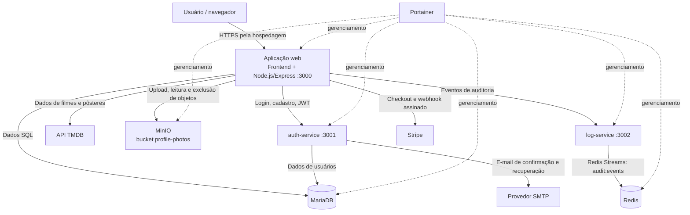
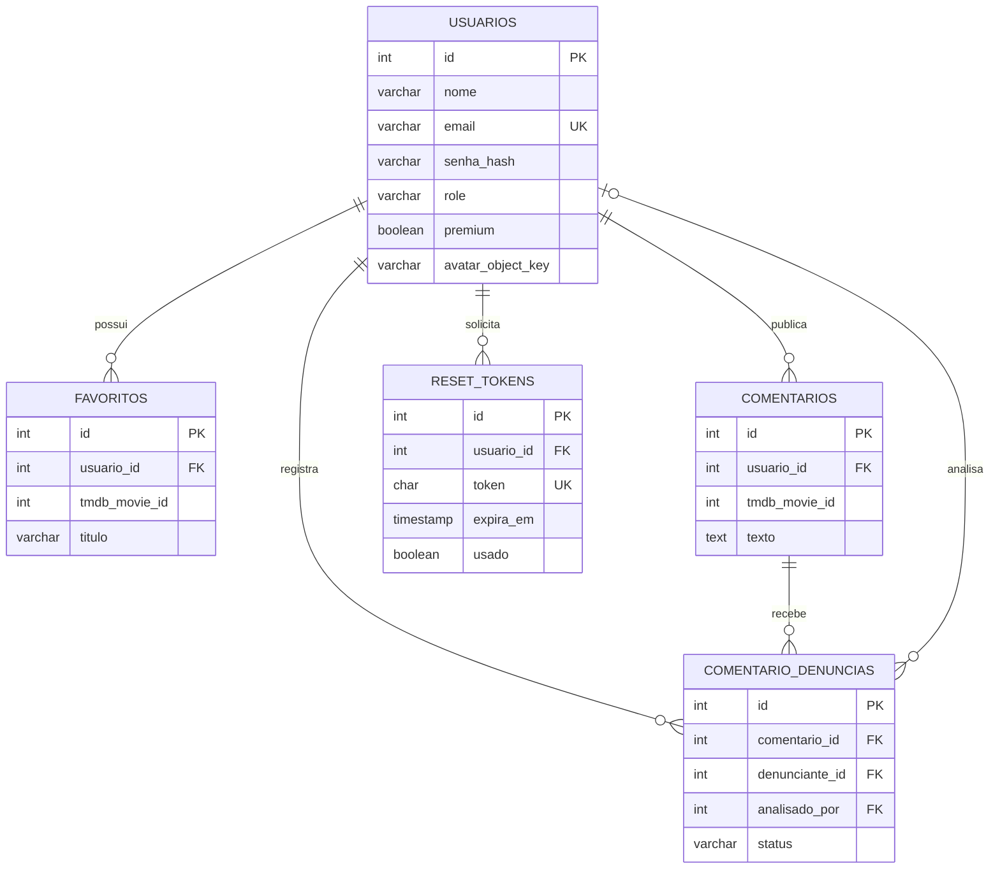

# Documentação técnica — Catálogo de Filmes: Tom Hanks

## 1. Objetivo e escopo

Este documento registra o funcionamento e a arquitetura identificados no código do projeto acadêmico desenvolvido para a disciplina ISW055 — Introdução à Computação em Nuvem, da FATEC Pompeia, semestre 2026.2.

A aplicação oferece um catálogo de filmes relacionados a Tom Hanks e recursos de conta, favoritos, comentários, moderação, auditoria, perfil e assinatura Premium. A documentação descreve a implementação existente no repositório; configurações de implantação podem variar entre o ambiente local, Codespaces e o ambiente de hospedagem.

## 2. Especificação funcional

### 2.1 Cadastro e autenticação

- O usuário pode criar uma conta informando nome, e-mail e senha.
- O sistema valida os campos e o formato do e-mail, verifica se o endereço já está cadastrado e exige senha com pelo menos seis caracteres.
- A senha é armazenada como hash gerado com bcryptjs, nunca como texto puro.
- Após o cadastro, o sistema envia uma mensagem para confirmação do e-mail. O token de confirmação tem validade limitada.
- O login confere a senha e exige que o e-mail esteja confirmado. O serviço de autenticação emite um JWT; a validade deve ser consultada na configuração efetiva do serviço.
- Existem operações para logout, consulta da sessão/usuário atual e recuperação e redefinição de senha.
- As rotas sensíveis de autenticação possuem limitação de tentativas.

### 2.2 Catálogo de filmes

- O catálogo consulta dados de filmes pela API externa TMDB.
- A aplicação apresenta os filmes e seus detalhes e permite que usuários interajam com os títulos.
- A rota `/api/poster` recupera imagens de pôster do TMDB pelo backend.
- A chave de acesso ao TMDB é fornecida por variável de ambiente e não deve ser exposta no frontend nem versionada no repositório.

### 2.3 Favoritos

- Usuários autenticados podem consultar, adicionar e remover filmes dos favoritos.
- Cada favorito está associado a um usuário e ao identificador do filme no TMDB.
- O banco impede que o mesmo filme seja adicionado mais de uma vez aos favoritos do mesmo usuário.
- O código aplica o limite de 10 favoritos para contas comuns e permite favoritos ilimitados para contas Premium.

### 2.4 Comentários e denúncias

- Usuários autenticados podem consultar e publicar comentários associados a filmes.
- O autor pode excluir o próprio comentário, conforme as permissões implementadas.
- Usuários podem denunciar comentários informando um motivo.
- Administradores podem consultar comentários e denúncias e atualizar o estado de uma denúncia para `ignorada` ou `resolvida`.
- A exclusão de registros relacionados respeita as regras de integridade referencial definidas no banco.

### 2.5 Perfil e foto de perfil

- A página de perfil exibe dados da conta, biografia, estado Premium, favoritos e, quando existente, a foto.
- O usuário pode atualizar os dados permitidos do próprio perfil.
- O envio de foto é um benefício Premium e aceita JPEG, PNG, WEBP ou GIF, com tamanho máximo de 5 MiB.
- A aplicação valida o tipo e a assinatura do arquivo antes do armazenamento.
- Os bytes da imagem são armazenados no MinIO; no banco é salvo o identificador do objeto em `usuarios.avatar_object_key`.
- A foto é recuperada por uma rota autenticada que consulta o objeto no MinIO.

### 2.6 Plano Premium e pagamento

- A aplicação oferece início de assinatura por meio do Stripe Checkout, configurado em modo de teste no projeto.
- A rota de checkout exige usuário autenticado e utiliza as configurações de ambiente do Stripe.
- O estado Premium é persistido na tabela `usuarios`; ser administrador não é a mesma coisa que ser Premium.
- O endpoint `POST /api/stripe/webhook` valida a assinatura recebida no cabeçalho `Stripe-Signature` usando o segredo configurado.
- O código trata eventos de conclusão de checkout e atualização/exclusão de assinatura para atualizar o estado Premium.
- Eventos de webhook são registrados para evitar que o mesmo evento seja aplicado mais de uma vez. O ambiente deve possuir a tabela `stripe_webhook_events` esperada pelo código.
- A ativação depende de evento válido e do estado de pagamento/assinatura verificado pelo backend; não deve depender apenas do retorno do navegador.

### 2.7 Auditoria e consulta administrativa

- A aplicação envia eventos de auditoria ao `log-service`, incluindo identificador do usuário quando disponível, ação, IP e detalhes.
- O serviço de logs armazena eventos no Redis Streams, no stream `audit:events`.
- O stream é limitado aproximadamente a 5.000 entradas para controlar seu crescimento.
- A consulta administrativa é disponibilizada por `GET /api/admin/logs`, com limite de resultados entre 1 e 100 e padrão de 50.
- A comunicação interna entre serviços usa o cabeçalho `X-Internal-Secret`. A rota administrativa também exige permissão de administrador.

### 2.8 Saúde e métricas

- `GET /health` verifica a conexão com o banco, o `auth-service`, o `log-service` e o MinIO, retornando estado de saúde e dependências.
- `GET /metrics` expõe métricas HTTP da aplicação, incluindo contagem de requisições por método/rota/status e soma de duração.
- A documentação OpenAPI/Swagger está disponível pelas rotas de documentação da aplicação e do serviço de autenticação.

## 3. Arquitetura da aplicação

O sistema é dividido em aplicação web, serviço de autenticação, serviço de logs e serviços de suporte. Os componentes comunicam-se pela rede Docker; as credenciais são fornecidas por variáveis de ambiente.

### Responsabilidades dos componentes

| Componente | Responsabilidade |
|---|---|
| Frontend e aplicação principal | Interface web, rotas de negócio, integração entre serviços, regras de favoritos, perfil, comentários, Premium, saúde e métricas |
| `auth-service` | Cadastro, login, confirmação de e-mail, recuperação de senha, emissão/validação de JWT e consulta de permissões |
| MariaDB | Persistência de usuários, favoritos, comentários, denúncias, tokens e dados relacionados à assinatura |
| `log-service` | Receber eventos internos autorizados e disponibilizar a consulta de logs |
| Redis | Persistir eventos de auditoria em Redis Streams |
| MinIO | Armazenar os arquivos das fotos de perfil |
| TMDB | Fornecer informações de filmes e imagens de pôster |
| SMTP | Enviar e-mails transacionais de confirmação e recuperação |
| Stripe | Processar o fluxo de checkout e notificar alterações de assinatura por webhook |
| Docker Compose | Definir serviços, variáveis, rede, dependências, volumes e verificações de saúde |
| Portainer | Gerenciar containers/stacks no ambiente de implantação |

## 4. Regras de negócio identificadas

1. **Conta:** nome, e-mail e senha são obrigatórios no cadastro; o e-mail deve ter formato válido e a senha deve conter ao menos seis caracteres.
2. **Confirmação:** o login não é permitido enquanto o e-mail não estiver confirmado.
3. **Segurança de senha:** senhas são armazenadas como hash bcrypt.
4. **Papéis:** as permissões de usuário comum e administrador são diferentes; privilégios administrativos não são concedidos por possuir Premium.
5. **Favoritos:** uma conta comum pode manter até 10 favoritos; uma conta Premium não tem esse limite. Um usuário não pode duplicar o mesmo filme em seus favoritos.
6. **Propriedade:** um usuário pode editar os próprios dados e excluir os próprios comentários, respeitando as permissões da rota; ações de moderação são restritas a administradores.
7. **Foto de perfil:** somente contas Premium podem enviar foto. O limite é 5 MiB e os formatos permitidos são JPEG, PNG, WEBP e GIF.
8. **Assinatura:** o estado Premium é atualizado no backend a partir de eventos Stripe validados; o segredo do webhook e as chaves de API devem permanecer em variáveis de ambiente.
9. **Auditoria:** apenas chamadas internas com o segredo compartilhado podem gravar eventos ou consultar diretamente os logs no serviço; a consulta administrativa passa pelo controle de permissão.
10. **Integridade:** favoritos, comentários, tokens e denúncias possuem relações com usuários ou comentários; as chaves estrangeiras definem o comportamento de exclusão.
11. **Limites:** o serviço de autenticação limita tentativas de operações sensíveis; o serviço de logs limita a quantidade consultada e o tamanho do stream.
12. **Falhas de dependências:** a rota de saúde sinaliza indisponibilidade quando alguma dependência obrigatória não responde.

## 5. Modelo de dados

O esquema principal está definido em `init.sql`; alterações posteriores são registradas em scripts de migração na pasta `database/`. A estrutura abaixo resume as tabelas identificadas no esquema e no código.

| Tabela | Finalidade | Campos e relações relevantes |
|---|---|---|
| `usuarios` | Conta, perfil, papel e estado Premium | `id` (PK), `nome`, `email` (único), `senha_hash`, `role`, `bio`, `avatar_object_key`, `premium`, IDs Stripe e datas de controle |
| `favoritos` | Filmes salvos pelos usuários | `id` (PK), `usuario_id` (FK), `tmdb_movie_id`, título, pôster e data; unicidade por usuário + filme |
| `comentarios` | Comentários associados a filmes | `id` (PK), `usuario_id` (FK), `tmdb_movie_id`, texto e data |
| `reset_tokens` | Tokens de redefinição de senha | `id` (PK), token único, `usuario_id` (FK), datas de criação/expiração e flag `usado` |
| `comentario_denuncias` | Denúncias e moderação de comentários | `comentario_id`, `denunciante_id`, motivo, estado, data de análise e `analisado_por`; referências a comentários e usuários |
| `stripe_webhook_events` | Controle de eventos Stripe já processados | O código insere `event_id` e `event_type`; a tabela precisa existir no banco implantado para o webhook funcionar |

### Relacionamentos principais

- Um usuário pode possuir vários favoritos, comentários, tokens de redefinição e denúncias.
- Cada favorito pertence a um usuário e identifica um filme por seu ID no TMDB; os dados do filme não são armazenados como uma tabela local de filmes nesse esquema.
- Cada comentário pertence a um usuário e identifica o filme pelo ID do TMDB.
- Uma denúncia referencia o comentário denunciado, o usuário denunciante e, quando analisada, o administrador responsável.
- A chave `avatar_object_key` referencia logicamente um objeto no MinIO; o conteúdo binário da imagem não é armazenado diretamente na tabela de usuários.
- Os IDs de cliente e assinatura Stripe são referências ao provedor externo, não tabelas de pagamento locais.

## 6. Integrações e variáveis de ambiente

As configurações são fornecidas por variáveis de ambiente, conforme `.env.example` e os arquivos de Compose. As variáveis abaixo são nomes de configuração; **não inclua valores reais no GitHub**.

| Grupo | Variáveis principais |
|---|---|
| Aplicação e endereços | `PORT`, `APP_URL`, `AUTH_SERVICE_URL`, `LOG_SERVICE_URL`, `TRUST_PROXY_HOPS` |
| Banco | `DB_HOST`, `DB_PORT`, `DB_NAME`, `DB_USER`, `DB_PASSWORD`, `DB_ROOT_PASSWORD` |
| Segurança interna | `JWT_SECRET`, `SESSION_SECRET`, `INTERNAL_SERVICE_SECRET` |
| TMDB | `TMDB_API_KEY` |
| E-mail | `MAIL_HOST`, `MAIL_PORT`, `MAIL_USER`, `MAIL_PASSWORD`, `MAIL_FROM` |
| MinIO | `MINIO_ENDPOINT`, `MINIO_ACCESS_KEY`, `MINIO_SECRET_KEY`, `MINIO_BUCKET`, `MINIO_REGION` |
| Stripe | `STRIPE_SECRET_KEY`, `STRIPE_WEBHOOK_SECRET`, `STRIPE_PRICE_ID` |

Os nomes de host usados em URLs internas, como `minio`, `redis` e `auth-service`, dependem dos nomes/aliases DNS disponíveis na rede Docker efetivamente implantada. Em caso de implantação em Portainer, confira os nomes de serviço e a rede definidos pela stack.

## 7. Classificação SaaS, PaaS e IaaS

Para esta atividade, a classificação considera o papel de cada camada na implantação do projeto. A classificação pode variar conforme o serviço contratado e o quanto da infraestrutura é administrado pelo provedor.

| Modelo | Aplicação no contexto do projeto | Justificativa |
|---|---|---|
| **IaaS** | Máquina virtual/servidor disponibilizado pela hospedagem | Representa a infraestrutura computacional sobre a qual os serviços são implantados. Quando a equipe administra o sistema operacional e a execução dos containers, essa responsabilidade permanece com a equipe. |
| **PaaS (camada de execução da aplicação)** | Containers do catálogo, `auth-service`, `log-service` e serviços de apoio orquestrados por Docker Compose/gerenciados no Portainer | No contexto didático da atividade, essa camada representa o ambiente de execução e gerenciamento dos componentes da aplicação. Tecnicamente, Docker e Portainer são ferramentas de conteinerização e gerenciamento; não constituem, por si só, um PaaS totalmente gerenciado pelo provedor. |
| **SaaS** | Stripe Checkout, API TMDB, provedor SMTP, GitHub/GitHub Actions e Docker Hub | Serviços externos consumidos pela aplicação ou pela equipe sem precisar desenvolver e operar internamente toda a plataforma oferecida por eles. |

MariaDB, Redis e MinIO são executados como serviços autogerenciados em containers no Compose. Portanto, neste repositório, não devem ser descritos como serviços gerenciados por terceiros. A classificação acima segue a perspectiva didática da atividade e explicita a diferença entre a camada de execução do projeto e um PaaS comercial totalmente gerenciado.

## 8. Segurança e operação

- Segredos, tokens e senhas de serviços devem ser configurados por ambiente e mantidos fora do versionamento.
- O backend aplica controles de autenticação e autorização nas rotas protegidas.
- O Helmet configura cabeçalhos HTTP de segurança; o rate limit reduz tentativas repetidas em rotas sensíveis.
- As comunicações internas que exigem confiança utilizam `INTERNAL_SERVICE_SECRET`.
- Health checks do Compose verificam a disponibilidade dos serviços e permitem identificar dependências indisponíveis.
- Os volumes e mecanismos de persistência devem ser avaliados no ambiente real. A configuração de desenvolvimento/Compose não deve ser assumida como política de backup ou alta disponibilidade de produção.
- A integração com Stripe deve ser validada por assinatura de webhook; não se deve ativar Premium confiando apenas em dados enviados pelo cliente.

## 9. Rotas principais identificadas

A lista é um resumo funcional das rotas encontradas no backend, não substitui a especificação OpenAPI.

| Método e rota | Finalidade |
|---|---|
| `POST /api/auth/register` | Cadastro |
| `POST /api/auth/login` | Login |
| `POST /api/auth/logout` | Logout |
| `GET /api/auth/me` | Consulta do usuário autenticado |
| `GET /api/auth/verify-email` | Confirmação de e-mail |
| `POST /api/auth/forgot-password` | Início da recuperação de senha |
| `POST /api/auth/reset-password` | Redefinição de senha |
| `GET /api/movies` | Consulta do catálogo |
| `GET /api/favorites` | Consulta de favoritos |
| `POST /api/favorites` | Adição de favorito |
| `DELETE /api/favorites/:id` | Remoção de favorito |
| `GET /api/profile/:id` | Consulta de perfil |
| `PATCH /api/profile/:id` | Atualização de perfil |
| `GET /api/profile/:id/avatar` | Consulta da foto de perfil |
| `POST /api/profile/:id/avatar` | Envio de foto de perfil |
| `POST /api/premium/checkout` | Início do checkout Premium |
| `POST /api/stripe/webhook` | Recebimento de eventos Stripe |
| `GET /api/comments/:movieId` | Consulta de comentários por filme |
| `POST /api/comments` | Publicação de comentário |
| `POST /api/comments/:id/report` | Denúncia de comentário |
| `DELETE /api/comments/:id` | Exclusão de comentário conforme permissão |
| `GET /api/admin/reports` | Consulta administrativa de denúncias |
| `PATCH /api/admin/reports/:id` | Atualização do estado de denúncia |
| `GET /api/admin/logs` | Consulta administrativa de auditoria |
| `GET /health` | Estado da aplicação e dependências |
| `GET /metrics` | Métricas HTTP |

## 10. Implantação e documentação complementar

O projeto é configurado para execução com Docker Compose. Os passos básicos estão no [README.md](./README.md); as variáveis necessárias estão listadas em `.env.example`. Endereços, portas publicadas e estado dos serviços podem variar conforme o ambiente.

A documentação OpenAPI da aplicação está em `docs/openapi-app.json`, e a do serviço de autenticação em `auth-service/openapi.json`. Para detalhes exatos de payloads e respostas, consulte esses arquivos e o código das rotas.

## 11. Limites desta documentação

Este documento foi elaborado a partir dos arquivos disponíveis no repositório. A configuração efetiva do ambiente de hospedagem, a existência de tabelas criadas manualmente e as variáveis configuradas no Portainer devem ser verificadas no ambiente implantado. Não são registradas como concluídas verificações que não foram executadas.

---

Projeto acadêmico — ISW055 — Introdução à Computação em Nuvem  
Tecnologia em Sistemas Inteligentes — FATEC Pompeia — 2026.2  
Aluna: Joice Soato Brito  
Professor: [Allan Lincoln Rodrigues Siriani](https://github.com/siriani)
